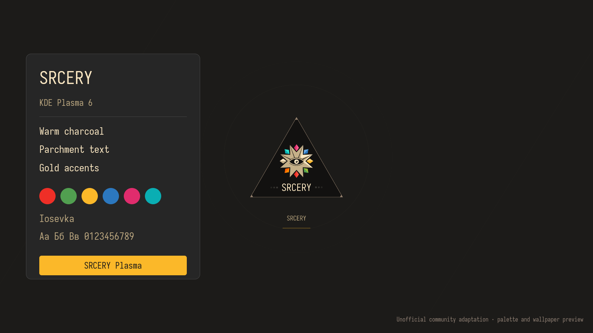

# SRCERY Plasma 1.0.0

Community adaptation by **SHANTI**.

Unofficial community adaptation for KDE Plasma 6. Warm charcoal (#1C1B19), parchment text (#FCE8C3), gold selection (#FBB829), Iosevka typography, native Breeze controls, and the official Srcery logo. Built and checked on Steam Deck OLED, Plasma 6.7.3 / Qt 6.11.1.

## Install

Requires Plasma 6, Breeze Qt style/decoration/cursors, Python 3, Fontconfig and KPackage tools. Run as your desktop user, without sudo:

    python3 install.py

To install and apply the complete appearance, including the grey logo wallpaper:

    python3 install.py --apply

To apply while preserving your current wallpaper or slideshow:

    python3 install.py --apply --keep-wallpaper

The native global theme defaults include `Wallpaper/Image=Srcery`. The complete bundle installs that wallpaper, the Plasma style, color scheme and actual Iosevka font. Installing only the inner look-and-feel folder does not install these companion files. This download is a manual-install suite, not a one-click KNewStuff dependency bundle.

No panel/widget layout is distributed or reset. The installer uses XDG user directories, backs up overwritten theme files and appearance settings under `~/.local/state/srcery-plasma/backups/`, and prints the backup path. It makes no network requests, modifies no system files and does not change the login manager or boot screen. Review install.py before running it. Backups include the desktop config for recovery; restoring the whole config also restores the layout as it was at backup time.

## Round icons

Tela Circle by vinceliuice is an optional separate dependency, not bundled or claimed as our artwork:
https://github.com/vinceliuice/Tela-circle-icon-theme
https://store.kde.org/p/1359276/

Download the official source, review its installer, then pass the extracted source directory:

    python3 install.py --apply --tela-source /path/to/Tela-circle-icon-theme

This invokes the upstream supported custom-color option with FBB829 and circular folders. It installs the base/light/dark variants under distinct Srcery-Circle names. Existing Srcery-Circle files are not overwritten. If that dependency is already installed, omit the argument to reuse it. Without it, the suite uses system Breeze Dark icons. Reapplying the native theme later retains the icon selection written by this installer.

## Included

- Global Theme: org.srcery.desktop, including embedded exact color roles and animated logo splash
- Native Plasma style: Srcery, with Breeze fallback
- Srcery.colors and Konsole Srcery profile/color scheme
- Unmodified Iosevka Regular 24.1.0, with SIL OFL 1.1
- Grey official-logo wallpaper, 3840×2160
- Source QML/SVG, installer and licence notices

Breeze GTK from your distribution is selected to follow KDE colors; this public bundle does not redistribute the device-specific GTK CSS. GTK/Flatpak apps and apps with their own styles may require separate configuration. Font and appearance updates may require closing and reopening existing applications. This splash appears when entering the Plasma desktop; it does not replace Steam Gaming Mode videos, firmware boot graphics or the login screen.

Palette and official assets: https://srcery.sh and https://github.com/srcery-colors/srcery-assets
Iosevka: https://github.com/be5invis/Iosevka
See NOTICE and LICENSES for attribution. The adaptation is not an official release of Srcery or KDE.
